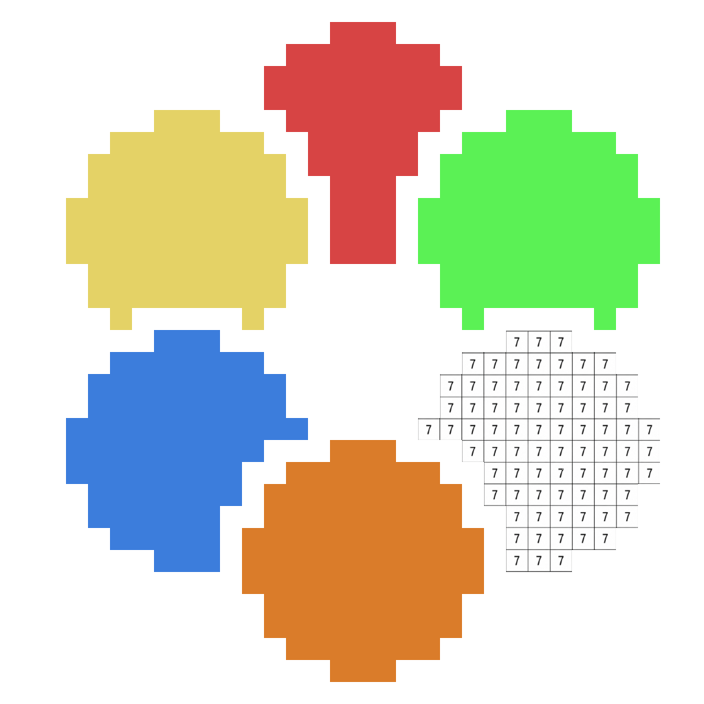

# Color by Number AP

A relaxing color-by-number for [Archipelago](https://archipelago.gg). Every numbered
color is an item: until someone sends you **Color 7**, the 7s stay blank.

**Play: https://ap-color-by-number.github.io/AP-Color-by-Number/** -- get the apworld and a
template yaml from the [latest release](https://github.com/AP-Color-by-Number/AP-Color-by-Number/releases/latest).

Inspired by a game proposal from Discord user **Dratini64**. Plays in the browser; upload your own pictures or
paint ones generated from your seed.

## How it plays

- **Pictures**: 1-20 per seed. Picture 1 is open; the rest need "Picture N Unlocked".
- **Colors**: 4-24 per picture, shared by every picture ("Color 3" works everywhere).
  You start with a few at random.
- **Uploads**: any image, shrunk to the seed's grid size and reduced to exactly the
  seed's color count. Let the game pick the colors, or choose your own: every cell
  then takes whichever of your colors is closest, with a live preview.
- **Recolor**: tap 🎨 on any color you have to change how it looks. It's cosmetic only;
  the number, its cells and its checks stay the same. "Reset colors" undoes it.
- **Checks**: each color in each picture pays out as you paint it: every 25%, 20% or 10%
  (the `color_checks` option). Plus four whole-picture milestones counted in finished
  colors (a quarter, half, three quarters, all), and, with `tool_checks`, using each tool
  3, 5 and 10 times.
  Whole-picture milestones count colors rather than cells because uploaded pictures
  are unknown at generation, so area is not something logic can promise.
- **Tools**: Paint Bucket (fills a connected patch) and Wide Brush (5x5), 5 charges
  each; refills add 3.
- **Traps** (none undo checks, none reset the picture): Smudge erases a few painted
  cells, Grayscale hides the colors for 45 s, Number Fog hides the numbers for 45 s.
- **Goal**: finish every picture.
- **Check list**: a side panel lists every check your seed has, built from your yaml's
  options, marked checked / can get now / needs an item (and what item), with a ★ on
  checks that hold something someone needs. Click a color's row to paint it.
- **Sound**: soft synthesized effects for painting, tools, checks, received items, traps and
  finished colors/pictures. Mute and volume are in the top bar.

Progress (pictures, paint, spent charges) is saved in the server's data storage under
`cbn_<team>_<slot>`, so it follows the slot to any device.

## Credits

- **Dratini64** (Discord): the original idea and design proposal that inspired this game.
- [archipelago.js](https://github.com/ThePhar/archipelago.js) (MIT) for the server connection.
